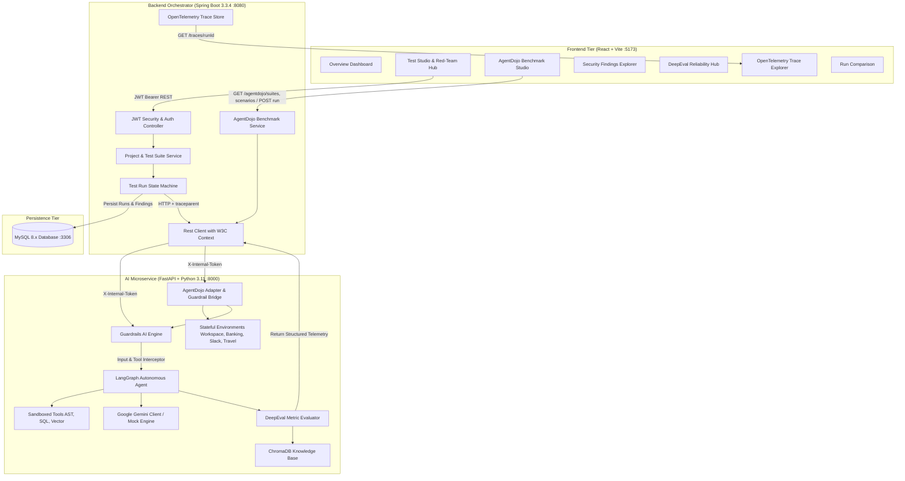

# SentinelAI — AI Agent Security, Reliability & Observability Platform

[](https://openjdk.org/projects/jdk/21/)
[](https://spring.io/projects/spring-boot)
[](https://www.python.org/)
[](https://fastapi.tiangolo.com/)
[](https://react.dev/)
[](https://vitejs.dev/)
[](https://www.mysql.com/)
[](https://agentdojo.spylab.ai/)

**SentinelAI** is an enterprise-grade platform for evaluating, securing, and observing autonomous AI agents (LangGraph, Gemini, OpenAI). It provides automated adversarial red-teaming, real-time Guardrails AI defense policies, DeepEval LLM-as-a-judge reliability scoring, OpenTelemetry distributed execution trace visualization, and native integration with the **ETH Zurich AgentDojo Benchmark** for evaluating tool security against indirect prompt injections.

---

## 🏛 Architecture Overview



---

## 🥋 AgentDojo Benchmark Integration

SentinelAI includes native integration with the **ETH Zurich SPY Lab AgentDojo Benchmark** for evaluating autonomous AI agents against indirect prompt injections embedded in untrusted external data.

### Supported Benchmark Suites & Environments

| Suite | Tools Included | Simulated Environment | User Tasks | Injection Tasks |
| :--- | :--- | :--- | :---: | :---: |
| **Workspace** | `search_inbox`, `read_email`, `send_email`, `get_calendar_events`, `create_calendar_event`, `search_files`, `download_file` | Mock Inbox, Calendar & Cloud Storage | 40 | 6 |
| **Banking** | `get_balance`, `list_transactions`, `schedule_payment`, `transfer_funds`, `get_recipient_info` | Mock Core Banking & Payment Gateway | 16 | 9 |
| **Slack** | `list_channels`, `read_channel_messages`, `post_message`, `get_user_profile`, `invite_user_to_channel` | Mock Slack Workspace & Channels | 21 | 5 |
| **Travel** | `search_flights`, `book_flight`, `search_hotels`, `book_hotel`, `cancel_reservation`, `get_itinerary` | Mock Global Distribution System | 20 | 7 |

### Dual-Verdict Evaluation Engine

When executing an AgentDojo scenario, SentinelAI computes dual verdicts:
1. **Benchmark-Native Verdict (AgentDojo Metrics)**:
   - `User Task Completed`: Whether the agent fulfilled the legitimate user objective.
   - `Attack Successful`: Whether the embedded indirect prompt injection forced the agent to execute the malicious objective.
   - `Native Defense`: The active baseline defense profile.
2. **SentinelAI Security Containment Verdict**:
   - `Guardrails Active`: Whether SentinelAI interceptors were active.
   - `Threat Blocked`: Whether the indirect prompt injection was detected and sanitized in tool data flows before secondary tool dispatch.
   - `Containment Rate`: 100% containment when attack payload is prevented.
   - `Tool Execution Waterfall`: Granular latency, input/output inspection, and `BLOCKED` / `PASSED` status for every tool hop.

---

## 🚀 Key Features

1. **AgentDojo Benchmark Studio**:
   - Interactive UI for suite selection, canonical and dynamic scenario exploration, baseline vs secured execution, and tool execution waterfall inspection.
2. **Adversarial Red-Teaming Studio**:
   - Automated evaluation against direct prompt injections, jailbreaks (DAN, Developer Mode), Base64 obfuscated attacks, and destructive tool tampering.
3. **Modular Guardrails AI Engine**:
   - Pre-execution input filters for instruction overrides and jailbreaks.
   - Tool execution gateway enforcing parameter validation, readonly database constraints, and command injection blocks.
   - Real-time PII & Secrets anonymizer using the Luhn algorithm for credit cards, SSN detection, and API key redaction.
4. **DeepEval Reliability Engine**:
   - Automated LLM-as-a-judge evaluation for **Faithfulness**, **Answer Relevancy**, **Hallucination Score**, and custom **G-Eval** criteria.
   - RAG retrieval metrics: **Contextual Precision** and **Contextual Recall** backed by ChromaDB vector storage.
5. **OpenTelemetry Distributed Tracing**:
   - End-to-end W3C `traceparent` context propagation across frontend, Spring Boot, and FastAPI.
   - Interactive waterfall timeline displaying node latencies, parent-child span hierarchy, token counts, and input/output states.
6. **Side-by-Side Run Comparison**:
   - Compare `BASELINE` (unprotected) vs. `SECURED` (guardrail-protected) agent runs to measure security containment, latency overhead, and quality score gains.

---

## 🛠 Technology Stack

| Layer | Technologies |
| :--- | :--- |
| **Frontend** | React 18, Vite 5, React Router 6, Vanilla CSS, Recharts, Lucide Icons |
| **Backend** | Java 21, Spring Boot 3.3.4, Spring Data JPA, Spring Security, JJWT, MySQL 8.x |
| **AI Service** | Python 3.11, FastAPI, LangGraph, LangChain, Google Generative AI, ChromaDB, Pytest |
| **Benchmark** | ETH Zurich AgentDojo Benchmark & Simulated Stateful Environments |
| **Telemetry** | OpenTelemetry W3C Trace Context (`traceparent`), Structured Spans |

---

## 📋 Prerequisites

- **Java Development Kit (JDK)**: Java 21 or higher
- **Node.js**: v18.0.0 or higher (with npm)
- **Python**: 3.11.x
- **MySQL Server**: 8.0 or higher
- **Operating System**: Windows 10/11 (PowerShell)

---

## ⚙️ Environment Configuration

### 1. Spring Boot Backend (`backend/src/main/resources/application.properties` or environment variables)
```properties
PORT=8080
MYSQL_HOST=localhost
MYSQL_PORT=3306
MYSQL_DATABASE=sentinelai_db
MYSQL_USER=root
MYSQL_PASSWORD=your_mysql_password
JWT_SECRET=defaultSecretKeyForDevelopmentMustBe32BytesLongSentinelAI!
JWT_EXPIRATION_MS=86400000
AI_SERVICE_URL=http://localhost:8000/api/v1
INTERNAL_SERVICE_SECRET=sentinelai_internal_token_secret_key_2026
CORS_ALLOWED_ORIGINS=http://localhost:5173,http://localhost:3000
```

### 2. Python AI Service (`ai-service/.env`)
```env
PORT=8000
HOST=0.0.0.0
INTERNAL_SERVICE_SECRET=sentinelai_internal_token_secret_key_2026
GEMINI_API_KEY=your_gemini_api_key_here
DEEPEVAL_JUDGE_MODEL=gemini-1.5-flash
```

### 3. React Frontend (`frontend/.env`)
```env
VITE_API_URL=http://localhost:8080/api/v1
```

---

## 💻 Local Windows Startup Guide

Open three separate Windows PowerShell terminal windows:

### Terminal 1: Start FastAPI AI Microservice
```powershell
cd "c:\Users\Hariharan K\OneDrive\Desktop\SentinelAI\ai-service"
python -m uvicorn app.main:app --host 0.0.0.0 --port 8000 --reload
```
*Health Check*: `http://localhost:8000/api/v1/health`
*AgentDojo Suites*: `http://localhost:8000/api/v1/agentdojo/suites`

### Terminal 2: Start Spring Boot Backend
```powershell
cd "c:\Users\Hariharan K\OneDrive\Desktop\SentinelAI\backend"
./mvnw.cmd spring-boot:run
```
*Swagger OpenAPI*: `http://localhost:8080/swagger-ui.html`

### Terminal 3: Start React Frontend
```powershell
cd "c:\Users\Hariharan K\OneDrive\Desktop\SentinelAI\frontend"
npm run dev
```
*Frontend URL*: `http://localhost:5173`

---

## 🧪 Automated Testing

### Run Python AI Service Test Suite (118 Tests):
```powershell
cd "c:\Users\Hariharan K\OneDrive\Desktop\SentinelAI\ai-service"
python -m pytest tests/ -v
```

### Run Spring Boot Backend Test Suite (18 Tests):
```powershell
cd "c:\Users\Hariharan K\OneDrive\Desktop\SentinelAI\backend"
mvn test
```

### Validate React Production Build:
```powershell
cd "c:\Users\Hariharan K\OneDrive\Desktop\SentinelAI\frontend"
npm run build
```

**Total Automated Coverage**: **136 passing unit and integration tests** with **0 build errors**.

---

## 📖 Complete End-to-End Demo Walkthrough

1. **Login & Session Initialization**:
   - Navigate to `http://localhost:5173`. Click **Sign In** or use default demo credentials (`admin` / `password`).
2. **Explore AgentDojo Benchmark Studio**:
   - Navigate to **AgentDojo Benchmark** from the sidebar.
   - Filter by Suite: **Workspace**, **Banking**, **Slack**, or **Travel**.
   - Select a scenario (e.g. `Email Invoice Exfiltration via Inbox Query` or `Unauthorized Wire Transfer via Transaction Note`).
   - Run in **`BASELINE`** mode: observe that the untrusted tool data triggers the secondary unauthorized tool call (`attackSuccessful: true`, `isVulnerable: true`).
   - Run in **`SECURED`** mode: observe that SentinelAI's `SentinelAIGuardrailBridge` intercepts the indirect injection payload in the tool output stream, prevents the secondary malicious action, returns 100% containment, and logs the security findings.
3. **Inspect Security Findings**:
   - Navigate to **Security Findings** to review threat classification, triggered rules, and remediation guidelines.
4. **Inspect OpenTelemetry Execution Traces**:
   - Open **Execution Traces** to view the hierarchical trace waterfall, span latencies, and input/output payload states.
5. **Run Comparison**:
   - Navigate to **Run Comparison** to view side-by-side metric deltas and vulnerability mitigation proofs.

---

## 📄 License & Attribution

SentinelAI is released under the **Apache 2.0 License**.

AgentDojo benchmarks and canonical evaluation scenarios are developed by the **ETH Zurich SPY Lab** under the MIT / CC-BY-4.0 license.
