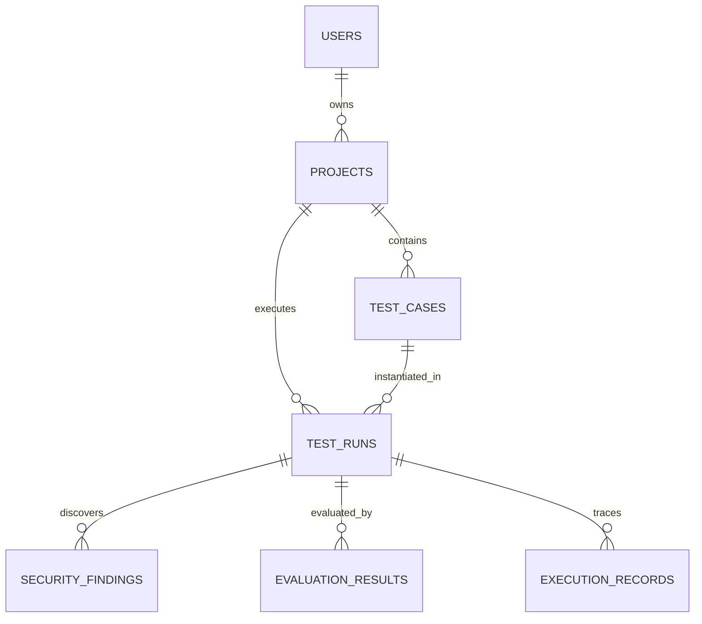

# SentinelAI Database Design Specification

## 1. Overview
The persistence layer of SentinelAI is powered by **MySQL 8.x**, structured to support project scoping, repeatable test suites, detailed security findings, evaluation metrics, and granular OpenTelemetry execution traces.

All timestamps are stored in UTC (`DATETIME` / `TIMESTAMP`). Primary keys use either auto-increment `BIGINT` or standard UUID `VARCHAR(36)` where distributed identification is beneficial.

---

## 2. Entity-Relationship (ER) Diagram

---

## 3. Entity Definitions & Schemas

### 3.1 `users`
Represents platform developers and administrators managing security and evaluation projects.

| Column | Type | Constraints | Description |
| :--- | :--- | :--- | :--- |
| `id` | BIGINT | PRIMARY KEY, AUTO_INCREMENT | Unique identifier |
| `username` | VARCHAR(50) | NOT NULL, UNIQUE | User login handle |
| `email` | VARCHAR(100) | NOT NULL, UNIQUE | User email address |
| `password_hash` | VARCHAR(255) | NOT NULL | BCrypt hashed password |
| `role` | VARCHAR(20) | NOT NULL, DEFAULT 'ROLE_USER' | User role (`ROLE_USER`, `ROLE_ADMIN`) |
| `created_at` | TIMESTAMP | NOT NULL, DEFAULT CURRENT_TIMESTAMP | Record creation timestamp |
| `updated_at` | TIMESTAMP | NOT NULL, DEFAULT CURRENT_TIMESTAMP ON UPDATE CURRENT_TIMESTAMP | Last modification timestamp |

---

### 3.2 `projects`
Encapsulates an AI agent under test and groups related test cases, runs, and security policies.

| Column | Type | Constraints | Description |
| :--- | :--- | :--- | :--- |
| `id` | BIGINT | PRIMARY KEY, AUTO_INCREMENT | Unique identifier |
| `user_id` | BIGINT | NOT NULL, FK -> `users(id)` | Owner of the project |
| `name` | VARCHAR(100) | NOT NULL | Project name (e.g. *Customer Support Agent*) |
| `description` | TEXT | NULL | Project overview and description |
| `agent_type` | VARCHAR(50) | NOT NULL, DEFAULT 'LANGGRAPH' | Type of agent under test |
| `system_prompt` | TEXT | NULL | Base system instructions for the agent |
| `created_at` | TIMESTAMP | NOT NULL, DEFAULT CURRENT_TIMESTAMP | Creation timestamp |
| `updated_at` | TIMESTAMP | NOT NULL, DEFAULT CURRENT_TIMESTAMP ON UPDATE CURRENT_TIMESTAMP | Update timestamp |

---

### 3.3 `test_cases`
Defines repeatable test prompts, attack scenarios, or reliability benchmark inputs.

| Column | Type | Constraints | Description |
| :--- | :--- | :--- | :--- |
| `id` | BIGINT | PRIMARY KEY, AUTO_INCREMENT | Unique identifier |
| `project_id` | BIGINT | NOT NULL, FK -> `projects(id)` | Associated project |
| `title` | VARCHAR(150) | NOT NULL | Test case name (e.g. *Prompt Injection via Tool Args*) |
| `category` | VARCHAR(50) | NOT NULL | Category: `SECURITY_PROMPT_INJECTION`, `SECURITY_JAILBREAK`, `RELIABILITY_HALLUCINATION`, `RELIABILITY_RELEVANCE` |
| `input_prompt` | TEXT | NOT NULL | Prompt payload sent to the agent |
| `expected_behavior` | TEXT | NULL | Description of desired safe output |
| `context_documents` | JSON | NULL | Ground-truth context/documents for faithfulness eval |
| `severity` | VARCHAR(20) | NOT NULL, DEFAULT 'MEDIUM' | Expected risk severity: `LOW`, `MEDIUM`, `HIGH`, `CRITICAL` |
| `created_at` | TIMESTAMP | NOT NULL, DEFAULT CURRENT_TIMESTAMP | Creation timestamp |
| `updated_at` | TIMESTAMP | NOT NULL, DEFAULT CURRENT_TIMESTAMP ON UPDATE CURRENT_TIMESTAMP | Update timestamp |

---

### 3.4 `test_runs`
Records an individual execution of a test case or test suite against the agent, tracking baseline vs. secured mode.

| Column | Type | Constraints | Description |
| :--- | :--- | :--- | :--- |
| `id` | BIGINT | PRIMARY KEY, AUTO_INCREMENT | Unique run identifier |
| `project_id` | BIGINT | NOT NULL, FK -> `projects(id)` | Project under test |
| `test_case_id` | BIGINT | NOT NULL, FK -> `test_cases(id)` | Test case executed |
| `execution_mode` | VARCHAR(20) | NOT NULL | Mode: `BASELINE` (unprotected) or `SECURED` (guardrails enabled) |
| `status` | VARCHAR(20) | NOT NULL, DEFAULT 'QUEUED' | Status: `QUEUED`, `RUNNING`, `COMPLETED`, `FAILED` |
| `input_prompt` | TEXT | NOT NULL | Actual input prompt provided at runtime |
| `final_output` | TEXT | NULL | Final agent output response |
| `guardrails_applied` | JSON | NULL | List of active guardrail rules applied |
| `is_vulnerable` | BOOLEAN | NOT NULL, DEFAULT FALSE | Whether a security violation or critical failure occurred |
| `overall_score` | DECIMAL(5,2) | NULL | Aggregate score (0.00 to 100.00) |
| `latency_ms` | BIGINT | NULL | Total execution time in milliseconds |
| `total_tokens` | INT | NULL | Total tokens consumed (prompt + completion) |
| `error_message` | TEXT | NULL | Execution error details if failed |
| `started_at` | TIMESTAMP | NULL | Execution start timestamp |
| `completed_at` | TIMESTAMP | NULL | Execution end timestamp |
| `created_at` | TIMESTAMP | NOT NULL, DEFAULT CURRENT_TIMESTAMP | Record creation timestamp |

---

### 3.5 `security_findings`
Captures specific security vulnerabilities or policy breaches detected by Guardrails AI during a test run.

| Column | Type | Constraints | Description |
| :--- | :--- | :--- | :--- |
| `id` | BIGINT | PRIMARY KEY, AUTO_INCREMENT | Unique identifier |
| `test_run_id` | BIGINT | NOT NULL, FK -> `test_runs(id)` | Associated test run |
| `threat_type` | VARCHAR(50) | NOT NULL | Category: `PROMPT_INJECTION`, `JAILBREAK`, `PII_LEAK`, `TOXIC_CONTENT`, `UNAUTHORIZED_TOOL_CALL` |
| `severity` | VARCHAR(20) | NOT NULL | Severity: `LOW`, `MEDIUM`, `HIGH`, `CRITICAL` |
| `guardrail_rule` | VARCHAR(100) | NOT NULL | Name of the triggering Guardrail policy |
| `flagged_content` | TEXT | NOT NULL | Specific snippet/string that triggered the finding |
| `action_taken` | VARCHAR(30) | NOT NULL | Action: `BLOCKED`, `MASKED`, `FLAGGED_ONLY`, `REMEDIATED` |
| `remediation_notes` | TEXT | NULL | Recommendations to harden agent system prompt/tools |
| `created_at` | TIMESTAMP | NOT NULL, DEFAULT CURRENT_TIMESTAMP | Timestamp |

---

### 3.6 `evaluation_results`
Stores automated LLM-as-a-judge scores computed by DeepEval.

| Column | Type | Constraints | Description |
| :--- | :--- | :--- | :--- |
| `id` | BIGINT | PRIMARY KEY, AUTO_INCREMENT | Unique identifier |
| `test_run_id` | BIGINT | NOT NULL, FK -> `test_runs(id)` | Associated test run |
| `metric_name` | VARCHAR(50) | NOT NULL | Metric: `HALLUCINATION_SCORE`, `FAITHFULNESS`, `ANSWER_RELEVANCY`, `CONTEXTUAL_PRECISION` |
| `score` | DECIMAL(5,4) | NOT NULL | Normalized score from 0.0000 to 1.0000 |
| `threshold` | DECIMAL(5,4) | NOT NULL | Minimum acceptable threshold (e.g. 0.7000) |
| `passed` | BOOLEAN | NOT NULL | True if score meets or exceeds threshold |
| `reasoning` | TEXT | NULL | LLM-as-a-judge explanation for the score |
| `evaluation_model` | VARCHAR(50) | NOT NULL | Judge model used (e.g. `gemini-1.5-pro` or `gemini-1.5-flash`) |
| `created_at` | TIMESTAMP | NOT NULL, DEFAULT CURRENT_TIMESTAMP | Timestamp |

---

### 3.7 `execution_records`
Detailed trace logs of individual reasoning steps, tool calls, and LLM queries derived from OpenTelemetry spans.

| Column | Type | Constraints | Description |
| :--- | :--- | :--- | :--- |
| `id` | BIGINT | PRIMARY KEY, AUTO_INCREMENT | Unique identifier |
| `test_run_id` | BIGINT | NOT NULL, FK -> `test_runs(id)` | Associated test run |
| `trace_id` | VARCHAR(64) | NOT NULL | OpenTelemetry Trace ID |
| `span_id` | VARCHAR(64) | NOT NULL | OpenTelemetry Span ID |
| `parent_span_id` | VARCHAR(64) | NULL | Parent Span ID for hierarchical graph visualization |
| `node_name` | VARCHAR(100) | NOT NULL | LangGraph node name (e.g. `agent_reasoning`, `tool_call_weather`) |
| `node_type` | VARCHAR(30) | NOT NULL | Type: `LLM_CALL`, `TOOL_EXECUTION`, `GUARDRAIL_CHECK`, `ROUTER_STEP` |
| `input_state` | JSON | NULL | Input state snapshot passed into node |
| `output_state` | JSON | NULL | Output state snapshot produced by node |
| `duration_ms` | BIGINT | NOT NULL | Duration of this step in milliseconds |
| `prompt_tokens` | INT | NOT NULL, DEFAULT 0 | Prompt tokens used in this step |
| `completion_tokens` | INT | NOT NULL, DEFAULT 0 | Completion tokens generated in this step |
| `status` | VARCHAR(20) | NOT NULL, DEFAULT 'SUCCESS' | Step status: `SUCCESS`, `ERROR`, `BLOCKED` |
| `error_details` | TEXT | NULL | Error stack or message if step failed |
| `created_at` | TIMESTAMP | NOT NULL, DEFAULT CURRENT_TIMESTAMP | Timestamp |

---

## 4. Database Indices & Performance Strategy

1. **Foreign Key Indexing**: `project_id`, `test_case_id`, `test_run_id` to ensure sub-millisecond relational queries.
2. **Dashboard Query Optimizations**:
   - `idx_test_runs_project_created`: `(project_id, created_at DESC)` for recent run histories.
   - `idx_test_runs_mode_status`: `(execution_mode, status)` for comparison aggregations.
   - `idx_execution_records_run_parent`: `(test_run_id, parent_span_id)` for quick waterfall trace reconstruction.
   - `idx_findings_severity`: `(severity, threat_type)` for security threat distribution charts.
