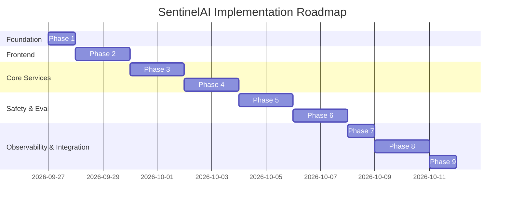

# SentinelAI Development Roadmap

This roadmap outlines the phased engineering milestones for developing **SentinelAI – AI Agent Security, Reliability & Observability Platform**.

---

## Milestone Overview

---

## Project Phase Status & Verification Tracker

| Phase | Description | Status | Verification Summary |
| :--- | :--- | :--- | :--- |
| **Phase 1** | Repository Audit, Architecture & Setup | **COMPLETE & FROZEN** | Verified project structure, architecture specifications, and data schemas. |
| **Phase 2** | ChromaDB RAG & Vector Pipeline | **COMPLETE & FROZEN** | Ingestion, chunking, embeddings, semantic retrieval, prompt defense. |
| **Phase 3** | Model Context Protocol (MCP) Integration | **COMPLETE & FROZEN** | MCP server, client, AST calculator, DB lookup, tool permission scopes. |
| **Phase 4** | Centralized LLM Gateway Implementation | **COMPLETE & FROZEN** | Provider abstraction (Gemini + Mock), RPM/TPM rate limiter, token metrics. |
| **Phase 5** | CrewAI Multi-Agent Security Workflow | **COMPLETE & FROZEN** | Analyst -> Tester -> Reporter agents, 109 Python tests + 14 Java tests passed. |

### Phase 5 Verification Metrics:
- **Python Tests**: 109 passed, 0 failed, 0 skipped (`python -m pytest tests/ -v`).
- **Java Tests**: 14 passed, 0 failed, 0 skipped (`mvn test`).
- **Total Platform Automated Tests**: 123 passing (100% pass rate).
- **Counting Invariant**: $\text{tests\_executed} = \text{tests\_passed} + \text{tests\_failed}$ verified across all execution states.

### Phase 5 Documented Boundaries & Known Limitations:
- **Live Gemini API**: Automated testing utilizes deterministic local mock providers; live Gemini calls were not tested.
- **Report Storage**: Crew assessment reports are stored in an in-memory registry and reset on service restart.
- **Tenant/User Isolation**: Assessment endpoints are secured via service-level token (`X-Internal-Token`); fine-grained multi-tenant RBAC is deferred.

---

## Phase Breakdown

### Phase 1: Project Foundation & Architecture (Current Phase)
* **Objective**: Establish project blueprints, directory structure, schema definitions, API contracts, environment configurations, and execution strategy.
* **Deliverables**:
  - Clean modular directory structure (`frontend/`, `backend/`, `ai-service/`, `docs/`).
  - Architecture blueprint (`docs/ARCHITECTURE.md`).
  - MySQL ER schema and database design (`docs/DATABASE_DESIGN.md`).
  - REST & internal service API specification (`docs/API_SPECIFICATION.md`).
  - Phased roadmap (`docs/DEVELOPMENT_ROADMAP.md`).
  - Environment templates (`.env.example` for all modules).
* **Completion Criteria**: Approved architectural foundation without application code.

---

### Phase 2: React Dashboard & Presentation Layer
* **Objective**: Build the responsive, cyber-security themed dashboard UI in React + Vite with Recharts and mock data feeds.
* **Deliverables**:
  - Application shell with Sidebar, Header, and Navigation.
  - **Overview Dashboard**: High-level security posture KPIs, vulnerability radar chart, recent test runs table.
  - **Test Studio**: Interface to construct prompts, choose baseline vs. secured mode, and select guardrail policies.
  - **Security Findings View**: Detailed vulnerability list with threat categories, severity tags, and remediation notes.
  - **Reliability & DeepEval Metrics View**: Metric gauges for Faithfulness, Hallucination, and Answer Relevancy.
  - **Observability Trace Waterfall**: Visual node-by-node execution timeline.
  - **Comparison Engine**: Side-by-side run difference visualizer.
* **Completion Criteria**: Interactive UI rendering all views with mock API contracts, fully responsive on desktop and laptop displays.

---

### Phase 3: Spring Boot Backend & MySQL Persistence
* **Objective**: Implement the backend API gateway, JWT authentication, MySQL schema migrations/entities, and project/run management.
* **Deliverables**:
  - Spring Security configuration with JWT filter, login, and registration.
  - JPA Entities and Repositories (`User`, `Project`, `TestCase`, `TestRun`, `SecurityFinding`, `EvaluationResult`, `ExecutionRecord`).
  - Services and REST Controllers for CRUD operations.
  - Spring `RestClient` integration for dispatching execution calls to FastAPI.
* **Completion Criteria**: All endpoints passing unit/integration tests with real MySQL database transactions.

---

### Phase 4: FastAPI & LangGraph Agent Sandbox
* **Objective**: Implement the Python AI microservice hosting the LangGraph agent state machine.
* **Deliverables**:
  - FastAPI application skeleton with internal token authentication middleware.
  - LangGraph `StateGraph` definition with simulated enterprise tools (e.g., mock customer database lookup, product catalog query).
  - Integration with Gemini LLM API via LangChain.
  - Single-turn and multi-step agent execution endpoints.
* **Completion Criteria**: Agent successfully processes prompts and autonomously resolves tool calls with deterministic error boundaries.

---

### Phase 5: AI Security Testing & Guardrails AI Engine
* **Objective**: Integrate Guardrails AI into the AI pipeline to detect and mitigate prompt injections, jailbreaks, PII leakage, and toxic content.
* **Deliverables**:
  - Pre-execution input validation guardrail pipeline.
  - Post-execution output validation guardrail pipeline.
  - Standardized threat categorization and structured `SecurityFinding` generation.
  - Baseline (unprotected) vs. Secured (guardrail-protected) toggle mechanisms.
* **Completion Criteria**: Injected prompts reliably caught and blocked in secured mode while failing securely in baseline mode.

---

### Phase 6: DeepEval Evaluation Engine
* **Objective**: Implement automated reliability, faithfulness, and hallucination scoring using DeepEval.
* **Deliverables**:
  - DeepEval test case runners for `HallucinationMetric`, `FaithfulnessMetric`, and `AnswerRelevancyMetric`.
  - Configurable scoring thresholds and LLM-as-a-judge reasoning extraction.
  - Automated evaluation trigger on test run completion.
* **Completion Criteria**: Reliable scores and explanations generated and returned for each agent execution.

---

### Phase 7: OpenTelemetry Observability & Tracing
* **Objective**: Instrument the LangGraph agent and safety pipeline with OpenTelemetry spans.
* **Deliverables**:
  - OpenTelemetry Python SDK custom span tracer.
  - Automatic span capturing for graph nodes, LLM queries, tool invocations, and guardrail checks.
  - Token counting (prompt tokens, completion tokens) and millisecond duration calculations.
  - Conversion of OTel spans into database-persistable execution records.
* **Completion Criteria**: Granular trace hierarchy exported and accurately structured for waterfall UI display.

---

### Phase 8: Full-Stack Integration & Run Comparison
* **Objective**: Connect React frontend, Spring Boot backend, FastAPI AI engine, and MySQL into an end-to-end operational platform.
* **Deliverables**:
  - Real API integration replacing frontend mock services.
  - Live test run trigger from UI -> Spring Boot -> FastAPI -> Gemini -> DeepEval -> DB -> UI.
  - Full side-by-side comparison feature comparing baseline and secured agent runs.
* **Completion Criteria**: End-to-end execution completes seamlessly in under 5 seconds with all metrics, traces, and findings correctly populated.

---

### Phase 9: Testing, Documentation, & Final Delivery
* **Objective**: End-to-end validation, documentation polish, performance tuning, and project portfolio package.
* **Deliverables**:
  - End-to-end test run demo scripts.
  - Complete `README.md` with local setup guide for Windows.
  - API documentation and test suite exports.
  - Codebase cleanup and final architectural audit.
* **Completion Criteria**: Clean build across all 3 tiers with comprehensive walkthrough instructions.
